

  <a href="https://bharat-singh-rawat.github.io/CV/cad/">
    <picture>
      <source media="(prefers-color-scheme: dark)" srcset="assets/hero-dark.gif">
      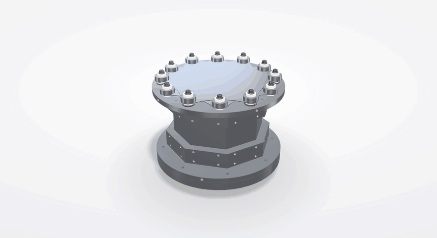
    </picture>
  </a>

<h1 align="center">Bharat Singh Rawat, Ph.D.</h1>

  <b>Accelerator physicist</b> · ion sources · beam diagnostics · antimatter traps · digital twins 
  Vancouver, Canada · previously University of Liverpool, Cockcroft Institute and CERN (AEgIS)

  
  
  
  
  

I design and model the hardware that makes and measures charged-particle beams: ion sources and their extraction grids, Faraday cups and energy analysers, and the Penning–Malmberg traps of CERN's AEgIS antimatter experiment. Most of it starts as a simulation and ends on a lab bench, and much of the code is here.

### 🔭 Now

<!-- NOW:START -->
**Accelerator Physicist** · Basilisk Industries, Vancouver, Canada · 10/2026 — Present

- Responsible for electron injector design, electron optics analysis and optimisation.
- Developing plasma and beam diagnostics such as B-dot probes, Faraday cups, Langmuir probes and current monitors.
<!-- NOW:END -->

### 🧪 Featured work

<table>
  <tr>
    <td width="33%" valign="top">
      <a href="https://github.com/Bharat-Singh-Rawat/PY-BEMCS">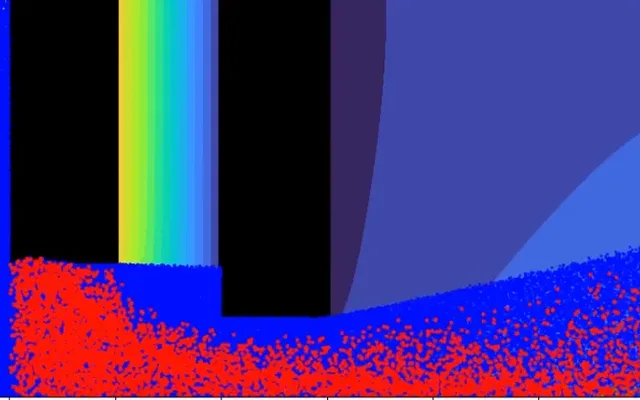</a> 
      <b>PY-BEMCS</b> 
      Ion-beam extraction and Monte Carlo Collision physics for ion sources, thrusters and fusion NBIs, with grid erosion and end-of-life prediction. 
      <a href="https://github.com/Bharat-Singh-Rawat/PY-BEMCS">Code</a>
    </td>
    <td width="33%" valign="top">
      <a href="https://github.com/Bharat-Singh-Rawat/IBSIMU-GUI">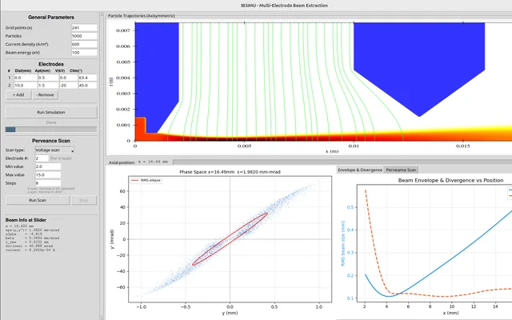</a> 
      <b>IBSIMU-GUI</b> 
      A graphical front end for modelling beam extraction through multi-electrode apertures, with the IBSimu solver underneath. 
      <a href="https://github.com/Bharat-Singh-Rawat/IBSIMU-GUI">Code</a>
    </td>
    <td width="33%" valign="top">
      <a href="https://bharat-singh-rawat.github.io/CV/cad/#penning">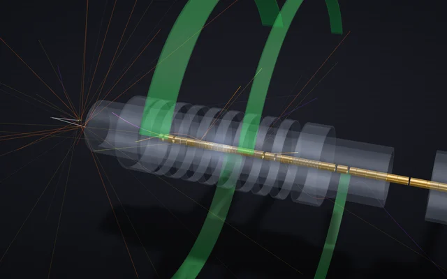</a> 
      <b>AEgIS Penning trap</b> 
      My G4beamline model of the AEgIS antiproton trap, with an interactive 3D version: antiprotons are caught, compressed and annihilate. 
      <a href="https://github.com/Bharat-Singh-Rawat/G4Beamline_AEgIS_Penning_Trap">Code</a> · <a href="https://bharat-singh-rawat.github.io/CV/cad/#penning">Live 3D</a>
    </td>
  </tr>
  <tr>
    <td width="33%" valign="top">
      <a href="https://bharat-singh-rawat.github.io/CV/cad/">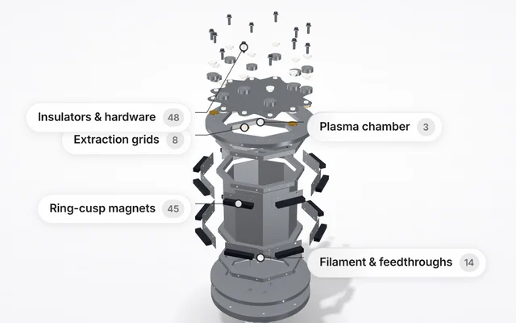</a> 
      <b>Hardware in 3D</b> 
      Instruments I built, straight from the CAD: scroll to take them apart, switch on the beam, see the magnetic field, or view them in AR. 
      <a href="https://github.com/Bharat-Singh-Rawat/CV/tree/main/cad">Code</a> · <a href="https://bharat-singh-rawat.github.io/CV/cad/">Live</a>
    </td>
    <td width="33%" valign="top">
      <a href="https://bharat-singh-rawat.github.io/AEgIS_Gravity_game/">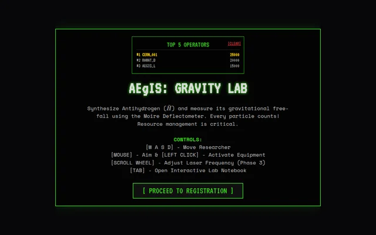</a> 
      <b>AEgIS Gravity Lab</b> 
      A browser game for outreach: make antihydrogen and measure its free fall, the way the AEgIS experiment does. 
      <a href="https://github.com/Bharat-Singh-Rawat/AEgIS_Gravity_game">Code</a> · <a href="https://bharat-singh-rawat.github.io/AEgIS_Gravity_game/">Play</a>
    </td>
    <td width="33%" valign="top">
      <a href="https://github.com/Bharat-Singh-Rawat/anni-desktop">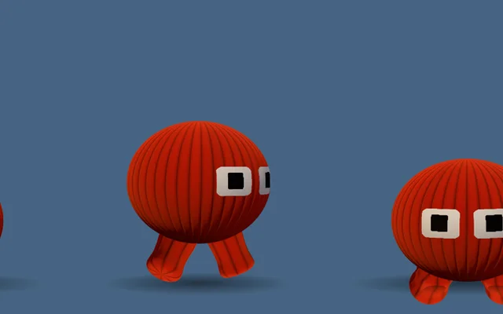</a> 
      <b>ANNI</b> 
      ANtiproton-ANtImatter: the corduroy plush from the Gravity game, now a 3D companion that lives on your desktop. 
      <a href="https://github.com/Bharat-Singh-Rawat/anni-desktop">Code</a>
    </td>
  </tr>
</table>

### 📄 Latest papers

<!-- PAPERS:START -->
- **Invasiveness study of supersonic gas-curtain-based ionization profile monitor for medical accelerators** · *Instruments (2026)* · [doi](https://doi.org/10.3390/instruments10030035)
- **Characterization of the extraction system of supersonic gas curtain-based ionization profile monitor for flash proton therapy** · *Instruments (2026)* · [doi](https://doi.org/10.3390/instruments10010004)
- **Design studies of a Retarding Potential Energy Analyser (RPEA) for low energy antimatter experiments** · *IBIC (2025)* · [doi](https://doi.org/10.18429/JACoW-IBIC2025-MOPMO02)
- **Faraday cups: principles, designs, and applications across scientific disciplines—a review** · *Instruments (2025)* · [doi](https://doi.org/10.3390/instruments9030020) · 🏆 Journal cover
- **3D simulation studies of mixed plasma confinement at AEgIS** · *EXA-LEAP (2025)* · [doi](https://doi.org/10.22323/1.480.0076)
<!-- PAPERS:END -->

All papers on <a href="https://scholar.google.com/citations?hl=en&user=gQP3HLAAAAAJ&view_op=list_works&sortby=pubdate">Google Scholar</a>.

### 📰 In the news

<!-- NEWS:START -->
- [New paper on spectrometry of highly charged ions from antiproton annihilations](https://www.liverpool.ac.uk/quasar/news/stories/title,1557662,en.php) · University of Liverpool · QUASAR, May 2026
- [From Pixels to Particles: young scientists tackle AEgIS challenges at British Science Week 2026](https://www.liverpool.ac.uk/quasar/news/stories/title,1551347,en.php) · University of Liverpool · QUASAR, Apr 2026
- [AEgIS collaboration meeting at CERN reviews breakthroughs and sets strategy for 2026](https://www.liverpool.ac.uk/quasar/news/stories/title,1542606,en.php) · University of Liverpool · QUASAR, Jan 2026
<!-- NEWS:END -->

### 🧰 Toolbox

  

Simulation: CST Studio, Geant4 / G4beamline, IBSimu, SIMION, Xsuite, Elmer FEM · Lab: ion and electron sources, Faraday cups, Langmuir probes, retarding potential analysers, vacuum and high voltage.

### 📈 Activity

  <a href="https://bharat-singh-rawat.github.io/CV/cad/#penning">
    <picture>
      <source media="(prefers-color-scheme: dark)" srcset="assets/contrib/penning-dark.svg">
      
    </picture>
  </a>

  <a href="https://bharat-singh-rawat.github.io/CV/">
    <picture>
      <source media="(prefers-color-scheme: dark)" srcset="assets/visitors/map-dark.svg">
      
    </picture>
  </a>

  

<b>🎮 Off duty</b> · the fun side: pixel me, trophies, a few favourite lines and the gamer room

 

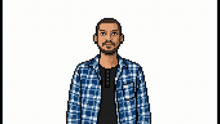

  

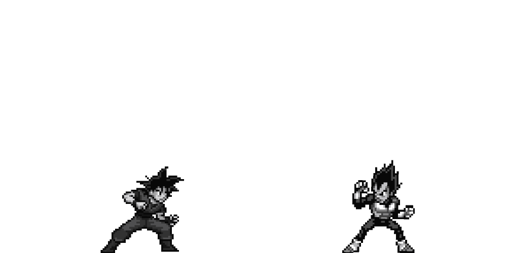

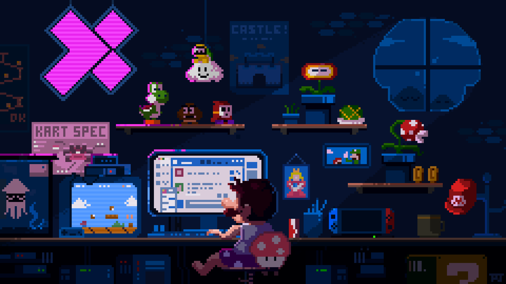

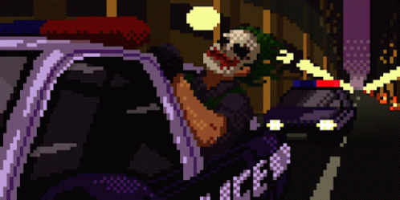

CV themes for fun: <a href="https://bharat-singh-rawat.github.io/Batman_Theme_CV_Template/">Batman</a> · <a href="https://bharat-singh-rawat.github.io/StrangerThings_CV_Template/">Stranger Things</a> · <a href="https://bharat-singh-rawat.github.io/Comic_Theme_CV_Template/">Spider-Verse comic</a> · <a href="https://bharat-singh-rawat.github.io/DosGame_Theme_CV_Template/">DOS game</a>

  

